# UPA 与 ULA 低反馈预编码正式仿真总结报告

**实验版本：** 协同仿真协议 v2.0；结果完成于 2026-10-17。
**覆盖内容：** UPA 32×32、ULA 64 阵元；CPU 与 UE 两种共相位计算链路；LOS 和 LOS+NLOS 信道。
**数据规模：** 四组正式运行各含 400 个 UE 位置、140 个配置、56,000 条逐样本结果，共 224,000 条记录。

## 1. 研究问题与比较方法

本实验关注低反馈方向信息能否支持协作 AP 预编码，以及共相位由 CPU 几何重构还是由 UE 测量 CSI 计算时，性能和反馈量如何变化。每个协作 AP 集合中，UE 只反馈 R=3 或 R=5 个参考 AP 的方向。CPU 与 UE 使用相同的方向消息、位置估计和最终发射波束；差别只在低反馈链路的共相位来源：CPU 从几何重构信道计算，UE 从带噪实测 CSI 计算并反馈量化相位。

比较方法包括 SVD 理想参考、Type-I、Type-II、HAQSE R=3/R=5、DFT R=3/R=5。SVD 使用真实信道作为无反馈上界；Type-I/II 使用带噪 CSI 和 UE 端共相位作为共同基线，其中 Type-I 为每 AP 单 DFT 波束，Type-II 为项目约定的双波束构造。协作 AP 数为 5–10；SNR 曲线的协作 AP 数固定为 8；反馈开销随 AP 数变化。每组图对 LOS、LOS+NLOS 分别统计 400 个位置的均值。

## 2. 场景与信道设置

|设置|UPA 主场景|ULA 主场景|
|---|---|---|
|AP 阵列|32×32 UPA，1024 阵元|64 阵元 ULA|
|载频、阵元间距|7 GHz，半波长间距|7 GHz，半波长间距|
|UE 阵列|4 阵元 ULA|4 阵元 ULA|
|AP 部署|冻结的 `UPA32_G50_C4_DFT_FINAL`，最小三维中心间距 4 m|冻结的 `ULA64_G50_H6_ORIGINAL`，场地 50 m、最小中心间距 6 m|
|UE 区域|x/y=20–30 m，z=0–5 m|x/y=20–30 m，z=0 m|
|方向码本|DFT 每维 4 倍过采样，128×128；HAQSE 每维 14 bit|DFT 8 倍过采样，512 个方向；HAQSE 空间频率 14 bit|
|观测 SNR|20、25、30、35、40 dB|20、25、30、35、40 dB|
|数据链路工作点|固定参考数据 SNR=10 dB，带宽 20 MHz|固定参考数据 SNR=10 dB，带宽 20 MHz|

UPA 保留三维 UE 定位；ULA UE 高度固定。两种阵列采用各自冻结的部署，吞吐量不应跨阵列直接解释为阵列本身的因果增益；应优先在同一阵列场景内比较算法和 CPU/UE 链路。

LoS 信道对每个 UE/AP 阵元对使用精确球面距离：

$$
[\mathbf H_{b,\mathrm{LOS}}]_{u,n}
= \frac{e^{-j k_0 r_{b,u,n}}}{r_{b,u,n}},\qquad k_0=\frac{2\pi}{\lambda},\quad \lambda=\frac{c}{7\,\mathrm{GHz}}.
$$

LOS+NLOS 场景在 LoS 上叠加 6 条共享单跳散射路径，并采用 K 因子为 10 dB（代入公式时取线性值 K=10）的 Rician 混合：

$$
\mathbf H_b=\sqrt{\frac{K}{K+1}}\mathbf H_{b,\mathrm{LOS}}
+\sqrt{\frac{1}{K+1}}\widetilde{\mathbf H}_{b,\mathrm{NLOS}}.
$$

散射分量按每台 AP 的 Frobenius 范数缩放后再混合。每个样本的 UE 位置、散射系数和逐 AP 标准噪声在各方法及两条链路间共享。观测噪声按当前活动 AP 的全局信道功率设定：

$$
\sigma^2=\frac{\mathrm{mean}(|\mathbf H_{\mathrm{true}}|^2)}{10^{\mathrm{SNR}_{\mathrm{obs}}/10}},\qquad
\mathbf H_{\mathrm{obs}}=\mathbf H_{\mathrm{true}}+\sigma\mathbf Z.
$$

图中的 20–40 dB 是 CSI 观测 SNR。吞吐量计算使用固定的 10 dB 数据工作点和 20 MHz 带宽；两者含义不同。数据链路功率系数固定为 $\rho=10/S_{\mathrm{ref}}$，其中 $S_{\mathrm{ref}}=0.25445623637403425$。吞吐量是从物理层频谱效率换算的结果，反馈 bit 数另行报告，没有从吞吐量中扣除控制开销。

## 3. 低反馈处理流程

### 3.1 参考 AP 方向反馈和定位

DFT 方向码字通过主右奇异向量与有限码本的最大相关选择：

$$
 i_b=\arg\max_i |\mathbf f_i^H\mathbf v_b|.
$$

HAQSE 输出的是阵列空间频率而非物理角度。ULA 单维频率采用圆周量化；UPA 两个局部空间频率分别采用端点量化。令每维量化级数为 $L=2^q$，则 ULA 的编码/解码为

$$
k=\mathrm{mod}(\mathrm{round}(L\nu),L),\qquad
\hat\nu=\mathrm{wrap}(k/L),
$$

UPA 的编码/解码为

$$
k_d=\mathrm{clip}(\mathrm{round}((\nu_d+0.5)(L-1)),0,L-1),\qquad
\hat\nu_d=-0.5+k_d/(L-1).
$$

本实验中 ULA 的 $q=14$，UPA 每维 $q=14$。UE 反馈这些整数，不反馈浮点角度或完整 CSI。

UE 对 R 个参考 AP 反馈 DFT 索引，或反馈 HAQSE 估计并量化的空间频率。CPU 解码方向后，以参考 AP 的几何射线求位置。设第 b 个 AP 的位置为 $\mathbf p_b$，单位方向为 $\mathbf g_b$，则射线投影矩阵为 $\mathbf P_b=\mathbf I-\mathbf g_b\mathbf g_b^T$。UPA 在三维坐标中求解；ULA 使用 x/y 投影并将 UE 高度固定为 $z=0$。非加权最小二乘位置估计（$d=3$ 对应 UPA，$d=2$ 对应 ULA）为

$$
\widehat{\mathbf p}=\arg\min_{\mathbf p}\sum_{b=1}^{R}
\|\mathbf P_b(\mathbf p-\mathbf p_b)\|_2^2
=\left(\sum_b\mathbf P_b\right)^{-1}
\left(\sum_b\mathbf P_b\mathbf p_b\right).
$$

再由估计位置推断未反馈 AP 的方向，并映射到其最终发射 DFT 波束。DFT 参考 AP 保留收到的索引；HAQSE 参考 AP 按其收到的频率生成发射索引。Type-I 在各 AP 独立选取单个最相关 DFT 波束；Type-II 使用两个 DFT 波束，并反馈幅度比与相对相位量化字段。

### 3.2 CPU 与 UE 的共相位

CPU 链路由估计位置和阵列朝向构造局部平面波几何信道（保留中心距离传播相位，但不重构散射残差），令 $\mathbf v_{\mathrm{model}}$ 为该模型的主右奇异向量，对实际发射波束计算

$$
 a_b=\mathbf f_b^H\mathbf v_{\mathrm{model},b},\qquad
 c_b=e^{j(\arg a_b-\arg a_1)},\qquad
 \mathbf w_b=\frac{c_b\mathbf f_b}{\sqrt B}.
$$

UE 链路使用带噪全网 CSI 的主右奇异向量 $\mathbf v_{\mathrm{obs}}$，对相同实际波束计算 $a_b^{\mathrm{UE}}=\mathbf f_b^H\mathbf v_{\mathrm{obs},b}$，再以 AP1 为参考量化相对相位。统一相位量化为 Q=4 bit：

$$
 \Delta\phi_b=\mathrm{wrap}(\arg(a_b^{\mathrm{UE}})-\arg(a_1^{\mathrm{UE}})),\quad
 k_b=\mathrm{mod}\!\left(\mathrm{round}\left(\frac{2^Q\Delta\phi_b}{2\pi}\right),2^Q\right),\quad
 \widehat c_b=e^{j2\pi k_b/2^Q},\quad k_1=0.
$$

UE 只反馈 $B-1$ 个相对相位整数；CPU 不接收完整 CSI。两条链路的预编码均按总功率 1、各 AP 等功率构造。

### 3.3 反馈开销口径

令 B 为协作 AP 数，R 为方向参考 AP 数。仅统计 UE 每次更新时发送的方向和相位字段，不含协议头、静态集合 ID、训练和下行控制。

|阵列与方向方案|CPU 链路反馈|UE 链路总反馈（含 4 bit 相位）|
|---|---:|---:|
|UPA DFT|14R bit|14R+4(B−1) bit|
|UPA HAQSE|28R bit|28R+4(B−1) bit|
|ULA DFT|9R bit|9R+4(B−1) bit|
|ULA HAQSE|14R bit|14R+4(B−1) bit|
|Type-I（UPA）|14B+4(B−1) bit|相同|
|Type-I（ULA）|9B+4(B−1) bit|相同|
|Type-II（UPA）|B(2×14+3+2)+4(B−1) bit|相同|
|Type-II（ULA）|B(2×9+3+2)+4(B−1) bit|相同|

例如 B=8、R=3 时，UPA 的 DFT 为 42/70 bit（CPU/UE），HAQSE 为 84/112 bit；ULA 的 DFT 为 27/55 bit，HAQSE 为 42/70 bit。Type-I 对应 UPA 140 bit、ULA 100 bit；Type-II 对应 292 bit 和 212 bit。

## 4. 评价指标

每个样本的接收信号模型为 $\mathbf y=\mathbf H\mathbf w s+\mathbf n$，理想单流接收合并下的有效信号功率为

$$
P=\|\mathbf H\mathbf w\|_2^2.
$$

归一化波束成形增益定义为

$$
G=\frac{\|\mathbf H\mathbf w\|_2^2}{\sigma_1^2(\mathbf H)},\qquad
G_{\mathrm{plot}}=\sqrt{\mathrm{mean}(G)},
$$

其中分母是理想单流最大增益。频谱效率和吞吐量按每个样本先计算、再对样本平均：

$$
\bar\eta=\frac1N\sum_{n=1}^N\log_2(1+\rho P_n),\qquad
T=W\bar\eta,
$$

W=20 MHz，因此 T 的单位为 bit/s（图表以 Mbps 显示）。位置误差采用三维或二维欧氏距离的均方根；相位误差采用环绕到 $[-\pi,\pi]$ 后的 AP 间相对相位 RMSE。通信性能样本不因位置或相位误差异常而删去。

## 5. CPU 端计算共相位

CPU 链路只获得 R 个参考 AP 的量化方向消息。CPU 根据方向射线估计 UE 位置，再推断其余协作 AP 的发射波束，并用位置和阵列朝向重构几何信道、计算连续共相位。它不获得 UE 的完整 CSI，也不反馈共相位。图中 Type-I、Type-II 仍是共同基线，继续由 UE 使用带噪 CSI 计算共相位；“CPU 端”只指 HAQSE/DFT 低反馈方案。

下面每张图均左右并列两个信道场景：左图为纯 LOS，右图为 LOS+NLOS（K=10 dB，含六条散射路径）。每个点是 400 个 UE 位置的均值，不含置信区间阴影。横轴观测 SNR 改变信道估计噪声；吞吐量按固定 10 dB 数据工作点和 20 MHz 带宽计算。

### 5.1 UPA 32×32：CPU 共相位

**吞吐量随观测 SNR 变化。** LOS 下 HAQSE 的 CPU 曲线接近 Type-I/II；DFT 方向量化经定位、相位重构后产生更明显损失。LOS+NLOS 下，CPU 几何模型没有重构散射残差，低反馈方法和 UE 相位基线之间的差距扩大。

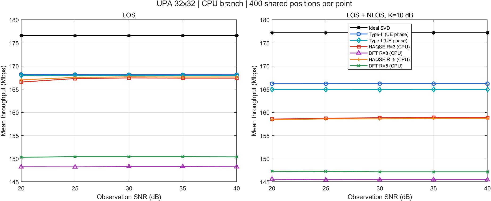

**吞吐量随协作 AP 数变化。** AP 数增加不保证 CPU 低反馈曲线单调上升：各 AP 等功率，总功率固定，而重构的 AP 间相位误差会破坏相干叠加。该图也显示，增加 AP 可以提升部分基线吞吐量，但不能自动修复低精度方向导致的相位偏差。

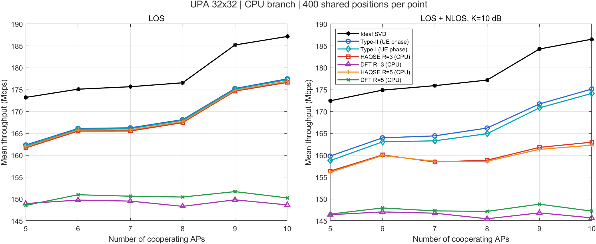

**归一化波束成形增益随观测 SNR 变化。** 该图按 $G_{\mathrm{plot}}=\sqrt{\mathrm{mean}(G)}$ 汇总，体现预编码对理想单流增益的保留程度。主要趋势与吞吐量图一致；它是归一化性能指标，吞吐量图则保留实际工作点和带宽口径。

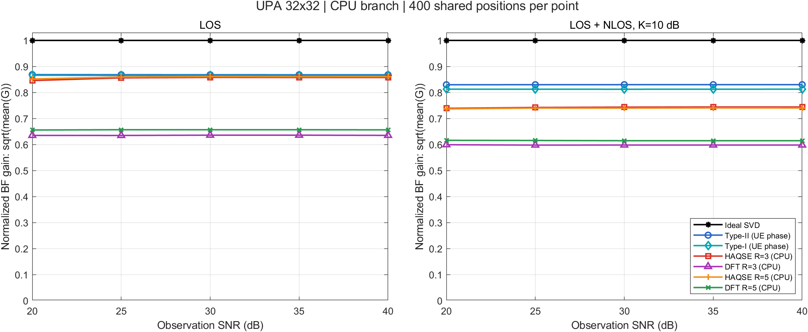

**反馈开销随协作 AP 数变化。** CPU 方案只计参考 AP 方向字段，因此固定 R 时方向反馈不随 B 增长；Type-I/II 基线还需逐 AP 反馈方向和相对相位字段。CPU 低反馈方案的开销更低，但应与同一图中的吞吐量和增益一起判断。

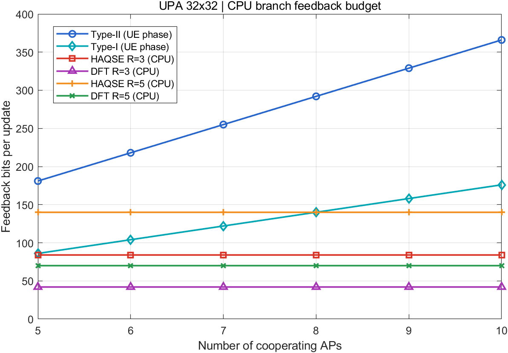

在 B=8、观测 SNR=30 dB 时，UPA DFT R=3 的 CPU 方向反馈为 42 bit，位置 RMSE 为 0.259 m；全 AP 对相位 RMSE 达 103.64°，吞吐量为 148.32 Mbps。HAQSE R=3 的方向反馈为 84 bit，LOS 下位置 RMSE 约 2.14 mm、相位 RMSE 21.27°、吞吐量 167.45 Mbps；但在 LOS+NLOS 下，CPU 相位 RMSE 上升到 84.78°，吞吐量为 158.87 Mbps。这里说明位置误差小并不自动保证共相位准确，尤其 CPU 模型未包含 NLOS 残差。

### 5.2 ULA 64：CPU 共相位

**吞吐量随观测 SNR 变化。** ULA 下也能看到相同机制：HAQSE CPU LOS 性能接近基线，DFT CPU 明显受方向量化和相位恢复误差影响；LOS+NLOS 对依赖几何重构的相位更加不利。

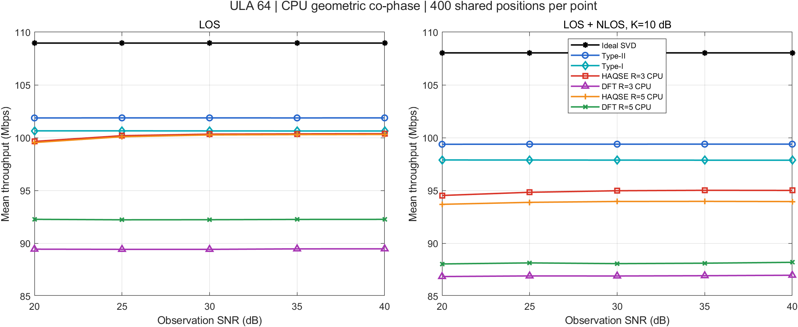

**吞吐量随协作 AP 数变化。** 固定总发射功率后增加 AP 改变了各 AP 的分功率和协同关系。Type-I/II 基线总体保持较高吞吐量；CPU DFT 的低反馈预算没有消除跨 AP 相位误差，所以性能与基线仍有明显差距。

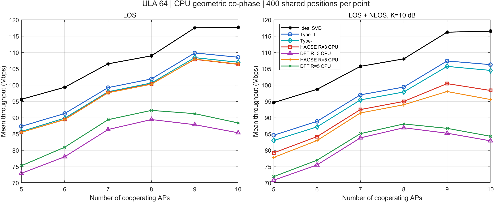

**归一化波束成形增益随观测 SNR 变化。** DFT CPU 的增益曲线低于 UE 相位基线，反映出问题主要出现在推断方向和几何共相位的联合链路，而不是反馈 bit 数本身。

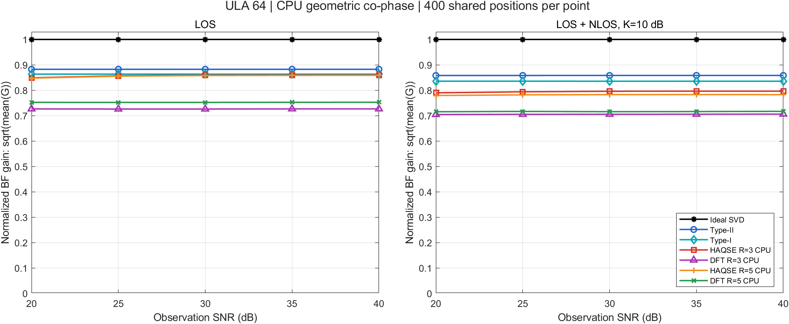

**反馈开销随协作 AP 数变化。** ULA DFT 每个参考 AP 反馈 9 bit 索引，HAQSE 每个参考 AP 反馈 14 bit 空间频率；CPU 端不计相位反馈。较低开销是以 CPU 端位置推断和相位重构承担性能风险为代价的。

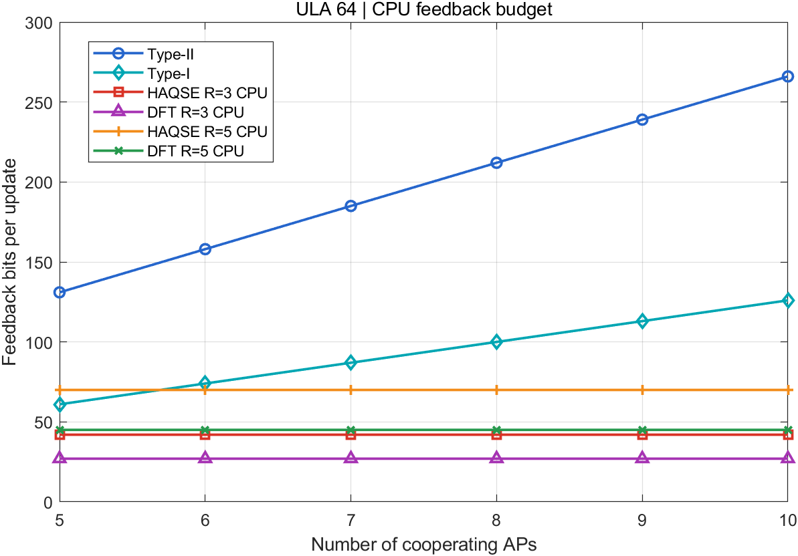

以 B=8、观测 SNR=30 dB 为例，ULA DFT R=3 的 CPU 链路只反馈 27 bit，但位置 RMSE 约 4.03 cm、全 AP 对相位 RMSE 90.09°，LOS 吞吐量为 89.42 Mbps；HAQSE R=3 反馈 42 bit，LOS 吞吐量为 100.34 Mbps，接近 Type-I 的 100.64 Mbps。LOS+NLOS 下 HAQSE CPU 相位 RMSE 为 63.23°，仍可见散射相位未被几何模型恢复的影响。

## 6. UE 端计算共相位

UE 链路保持与 CPU 链路相同的参考 AP 方向消息、位置估计和全部 AP 发射波束。区别是 UE 利用本地带噪全网 CSI，在实际发射波束上计算 AP 间相对共相位，并反馈每个非参考 AP 4 bit 相位整数。CPU 收到方向和相位整数后组装预编码，不需要收到完整信道矩阵。

每张图仍是左侧纯 LOS、右侧 LOS+NLOS（K=10 dB，六条散射路径），每点均值取自 400 个共享 UE 位置。UE 利用观测 CSI 计算相位，所以即使真实信道含 NLOS 散射，它也能通过观测吸收部分实际相位差；残余误差主要受观测噪声、有限方向反馈和 4 bit 相位量化影响。

### 6.1 UPA 32×32：UE 共相位

**吞吐量随观测 SNR 变化。** UPA 的 DFT/HAQSE UE 方案整体靠近 Type-I/II 基线，且 LOS 与 LOS+NLOS 两种场景下均保持稳定。和 CPU 端对应图相比，DFT 方案的吞吐量明显恢复，说明 UE 实测 CSI 计算共相位能弥补 CPU 几何重构的相位偏差。

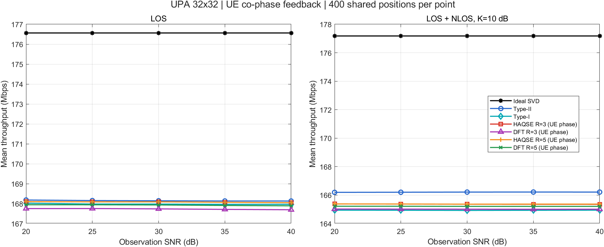

**吞吐量随协作 AP 数变化。** UE 相位反馈使低反馈方法在 AP 数变化时更贴近共同基线；AP 数增加仍会受固定总功率、方向推断和信道实现影响，因此应结合 LOS/NLOS 两个子图观察，不宜把单一 AP 数的起伏解读为算法普遍趋势。

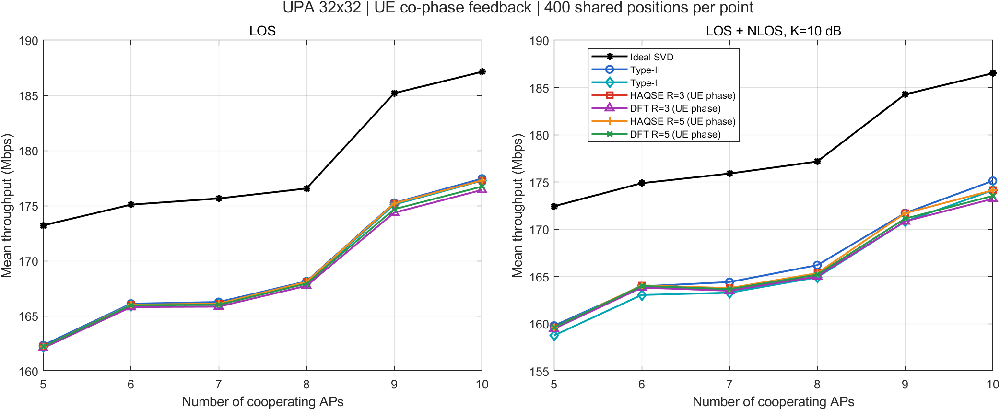

**归一化波束成形增益随观测 SNR 变化。** UE 端相位校准后，低反馈 DFT/HAQSE 曲线接近 Type-I，说明只反馈参考 AP 的方向并补充量化相位，已能保留大部分归一化波束增益。

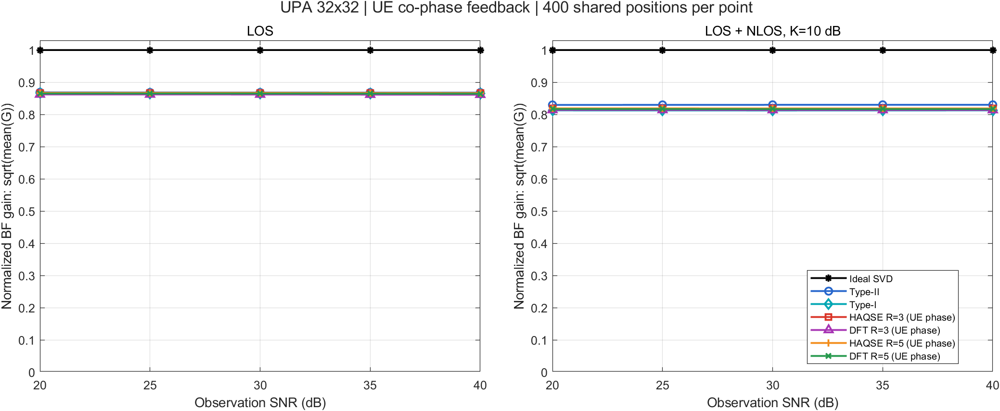

**反馈开销随协作 AP 数变化。** UE 端需额外反馈 $4(B-1)$ 个相位 bit，开销会随协作 AP 数增加；但 B=8、R=3 时 DFT 总反馈为 70 bit，相对 Type-I 的 140 bit 节省 50%，吞吐量仍接近 Type-I。HAQSE R=3 为 112 bit，相对 Type-I 节省 20%。

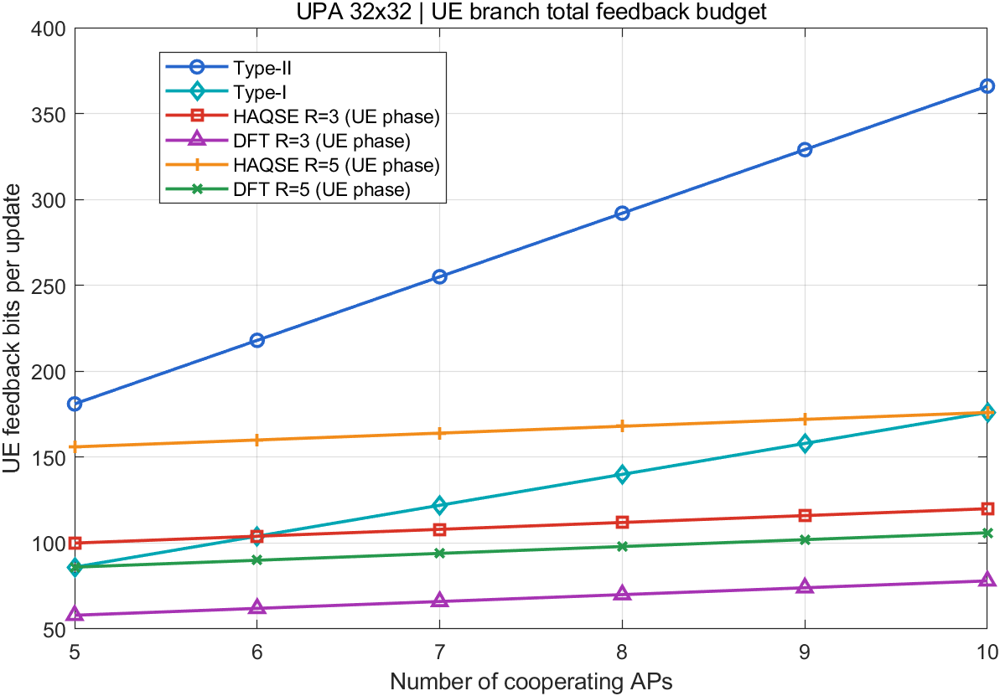

UPA DFT R=3 在 B=8、30 dB 时的全 AP 对相位 RMSE 为 LOS 11.52°、LOS+NLOS 8.93°；相应吞吐量为 167.74 Mbps 和 165.01 Mbps。HAQSE R=3 的 UE 相位 RMSE分别为 12.16° 和 8.97°，吞吐量分别为 168.09 Mbps 和 165.36 Mbps。该结果与 CPU 端 103.64°/103.91° 的 DFT 相位 RMSE形成明显对照。

### 6.2 ULA 64：UE 共相位

**吞吐量随观测 SNR 变化。** ULA UE 端 DFT R=3、HAQSE R=3 曲线接近 Type-I，LOS 与 LOS+NLOS 下都能保持基线附近的吞吐量。它们比 CPU DFT 链路更稳定，原因是 UE 相位来自带噪测量 CSI，而不是稀疏方向估计得到的位置。

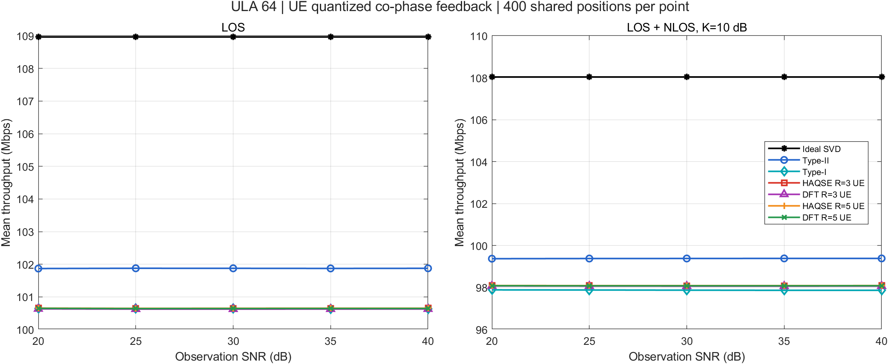

**吞吐量随协作 AP 数变化。** 低反馈 UE 方案随 AP 数变化的趋势接近共同基线；每增加一个协作 AP，UE 相位反馈新增 4 bit。吞吐量和开销应联合阅读，以判断增加协作 AP 是否带来足够的系统收益。

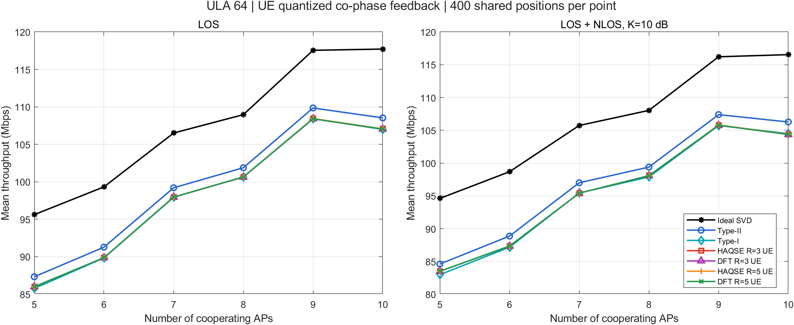

**归一化波束成形增益随观测 SNR 变化。** DFT/HAQSE 低反馈方案与 Type-I 的差距较小，进一步说明 UE 端相位信息能使稀疏方向反馈用于相干多 AP 发射。

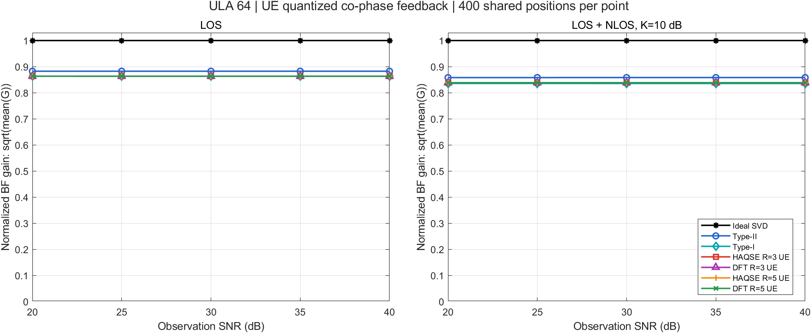

**反馈开销随协作 AP 数变化。** B=8、R=3 时 DFT 总反馈为 55 bit，对比 Type-I 的 100 bit 节省 45%；HAQSE 总反馈为 70 bit，节省 30%。结合吞吐量图，UE 端 DFT R=3 在 LOS 下为 100.62 Mbps，LOS+NLOS 下为 98.07 Mbps，Type-I 对应为 100.64 Mbps 和 97.88 Mbps。

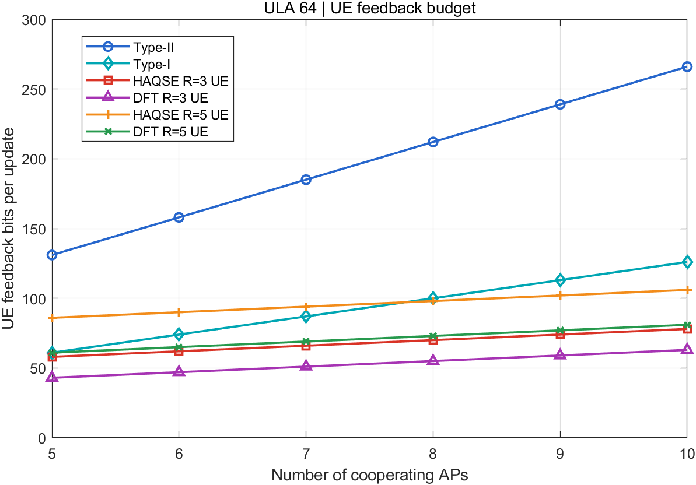

## 7. B=8、观测 SNR=30 dB 的定点对照

下表集中列出 SVD 理想参考、Type-I/II 基线和 R=3/R=5 低反馈方案。吞吐量为 400 个 UE 位置的均值，CPU/UE bit 分别对应 CPU 端方向消息开销和 UE 端方向加相位总开销。SVD 使用真实信道且不计反馈，作为性能上界；Type-I/II 的共相位由 UE 基于带噪 CSI 计算。

### UPA 32×32

|信道|方法|CPU 吞吐量 Mbps|UE 吞吐量 Mbps|CPU/UE bit|
|---|---|---:|---:|---:|
|LOS|SVD 理想上界|176.56|176.56|—|
|LOS|Type-II|168.14|168.14|292/292|
|LOS|Type-I|167.98|167.98|140/140|
|LOS|HAQSE R=3|167.45|168.09|84/112|
|LOS|DFT R=3|148.32|167.74|42/70|
|LOS|HAQSE R=5|167.68|168.09|140/168|
|LOS|DFT R=5|150.45|167.94|70/98|
|LOS+NLOS|SVD 理想上界|177.18|177.18|—|
|LOS+NLOS|Type-II|166.21|166.21|292/292|
|LOS+NLOS|Type-I|164.93|164.93|140/140|
|LOS+NLOS|HAQSE R=3|158.87|165.36|84/112|
|LOS+NLOS|DFT R=3|145.48|165.01|42/70|
|LOS+NLOS|HAQSE R=5|158.62|165.37|140/168|
|LOS+NLOS|DFT R=5|147.17|165.21|70/98|

### ULA 64

|信道|方法|CPU 吞吐量 Mbps|UE 吞吐量 Mbps|CPU/UE bit|
|---|---|---:|---:|---:|
|LOS|SVD 理想上界|108.96|108.96|—|
|LOS|Type-II|101.87|101.87|212/212|
|LOS|Type-I|100.64|100.64|100/100|
|LOS|HAQSE R=3|100.34|100.65|42/70|
|LOS|DFT R=3|89.42|100.62|27/55|
|LOS|HAQSE R=5|100.26|100.65|70/98|
|LOS|DFT R=5|92.23|100.64|45/73|
|LOS+NLOS|SVD 理想上界|108.03|108.03|—|
|LOS+NLOS|Type-II|99.39|99.39|212/212|
|LOS+NLOS|Type-I|97.88|97.88|100/100|
|LOS+NLOS|HAQSE R=3|94.97|98.09|42/70|
|LOS+NLOS|DFT R=3|86.90|98.07|27/55|
|LOS+NLOS|HAQSE R=5|93.96|98.09|70/98|
|LOS+NLOS|DFT R=5|88.07|98.08|45/73|

## 8. 结果归纳与解释边界

1. **UE 共相位链路体现低反馈方案的主要通信收益。** UE 使用本地带噪 CSI 计算实际波束上的相位，只反馈量化后的 AP 间相对相位。B=8、R=3 时，UE DFT 相比 Type-I 在 UPA 和 ULA 分别节省 50% 和 45% bit，同时吞吐量接近 Type-I。
2. **CPU 共相位链路暴露了几何相位恢复的敏感性。** 三个参考 AP 的方向可以定位用户并推断其余 AP 波束，但位置误差转成载波相位误差后会显著影响多 AP 相干叠加。DFT CPU 结果尤其明显；增加方向索引数 R 从 3 到 5 并未消除相位误差。
3. **LOS+NLOS 是混合信道而非纯 NLOS。** 仿真叠加 K=10 dB 的六条散射路径。UE 端计算可利用实测混合信道；CPU 的几何 LOS 重构不包含散射残差，所以 CPU 相位 RMSE 和吞吐量受影响更大。
4. **观测 SNR 与数据 SNR分开解释。** 20–40 dB 横轴控制估计噪声；吞吐量使用固定 10 dB 数据工作点并乘 20 MHz 带宽。当前吞吐量没有扣除反馈占用时频资源后的净开销，因此报告中应称为固定工作点吞吐量，而不是扣除控制开销后的净吞吐量。
5. **UPA 与 ULA 的绝对吞吐量不用于直接比较阵列优劣。** 两者阵列规模、用户高度约束和 AP 部署不同。算法收益应在各自冻结场景内与同一基线比较。

## 9. 文件索引

- 四组逐样本数据、汇总 CSV、反馈预算、运行日志、审计文件及 PNG/MATLAB FIG：`results/full400_UPA_CPU_20261017/`、`results/full400_UPA_UE_20261017/`、`results/full400_ULA_CPU_20261017/`、`results/full400_ULA_UE_20261017/`。
- 两种阵列的 CPU/UE B=8、30 dB 对照表：`results/UPA_CPU_UE_B8_OBS30_comparison.csv`、`results/ULA_CPU_UE_B8_OBS30_comparison.csv`。
- UPA 协议数值核查：`verification.json`、`verification_ue.json`；ULA 数值核查：`verification_ula.json`；完整结果审计 JSON 随对应正式结果保存。
- 冻结几何、UE 位置、散射、噪声、运行清单及双方同步配置：`shared/`。
- MATLAB 运行入口：`run_upa_cpu.m`、`run_upa_ue.m`、`run_ula_cpu.m`、`run_ula_ue.m`。