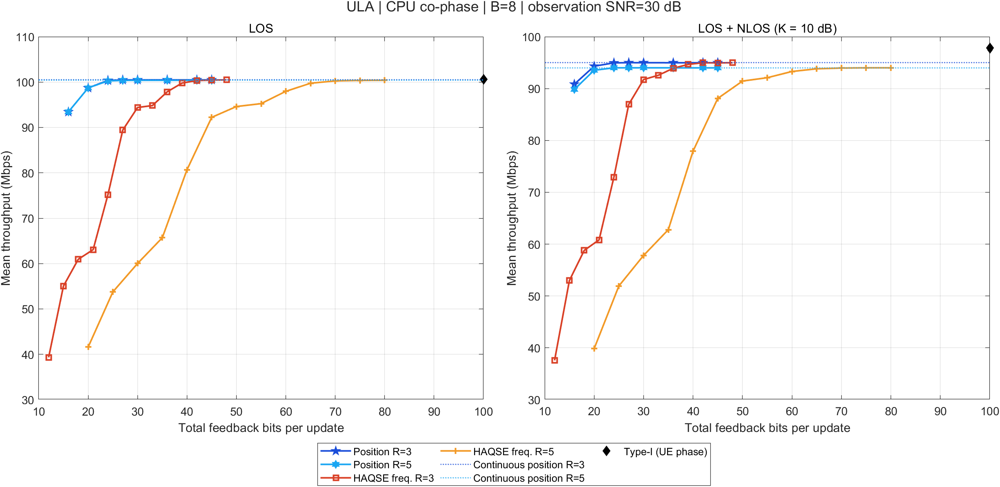
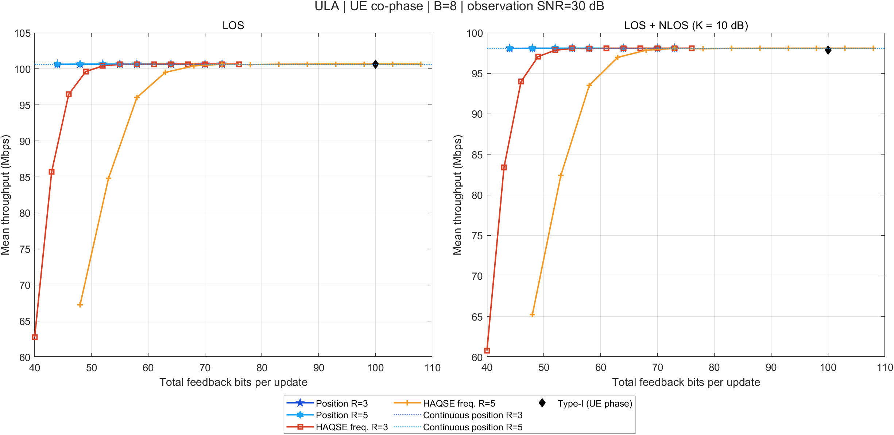
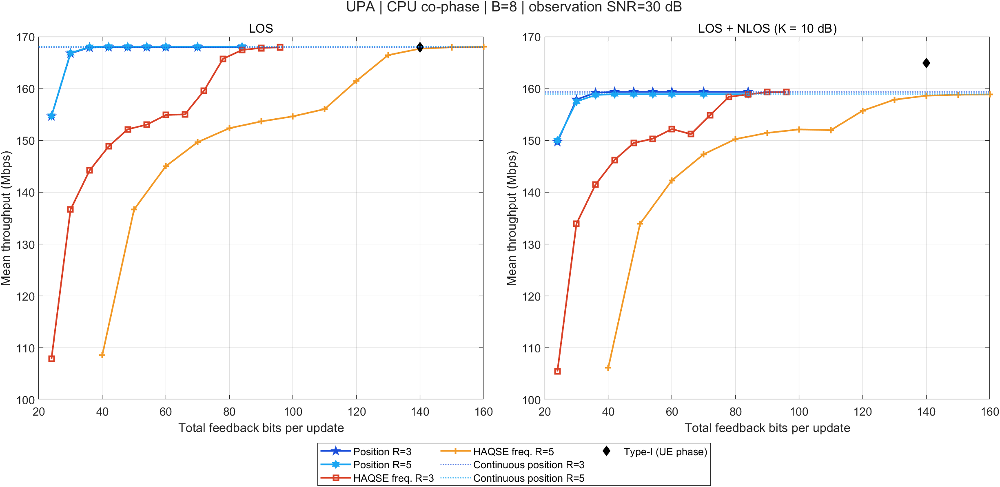
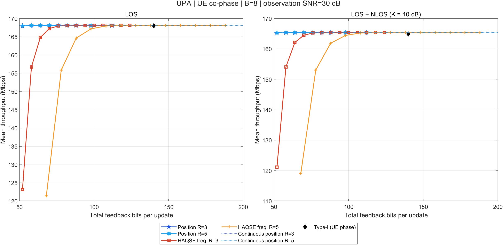

# 位置反馈加入CPU与UE仿真的结果

本轮按用户确认，在CPU和UE两条链路统一采用相对AP1路径差敏感度分配坐标bit。位置编码在UE端使用连续HAQSE方向及原无权射线定位；CPU只接收量化坐标及公共配置。原正式部署、400位置、观测噪声和七条方法均保留。

## 主要结果

ULA的R3位置反馈：纯LOS下，CPU/UE吞吐量为100.365/100.650 Mbps，相对Type-I损失为0.273%/-0.010%；LOS+NLOS下，CPU/UE吞吐量为94.953/98.091 Mbps，相对Type-I损失为2.985%/-0.220%。

UPA的R3位置反馈：纯LOS下，CPU/UE吞吐量为167.920/168.090 Mbps，相对Type-I损失为0.035%/-0.066%；LOS+NLOS下，CPU/UE吞吐量为159.200/165.363 Mbps，相对Type-I损失为3.472%/-0.265%。

|阵列|信道|相位端|方法|反馈bit|吞吐量Mbps|相对Type-I损失%|相对Type-I节省bit%|
|---|---|---|---|---|---|---|---|
|ULA|LOS|CPU|TypeI|100|100.640|0.000|0.00|
|ULA|LOS|CPU|HAQSE_R3|42|100.336|0.303|58.00|
|ULA|LOS|CPU|DFT_R3|27|89.422|11.147|73.00|
|ULA|LOS_NLOS_K10|CPU|TypeI|100|97.875|0.000|0.00|
|ULA|LOS_NLOS_K10|CPU|HAQSE_R3|42|94.975|2.964|58.00|
|ULA|LOS_NLOS_K10|CPU|DFT_R3|27|86.898|11.216|73.00|
|ULA|LOS|CPU|POS_R3|24|100.365|0.273|76.00|
|ULA|LOS_NLOS_K10|CPU|POS_R3|24|94.953|2.985|76.00|
|ULA|LOS|UE|TypeI|100|100.640|0.000|0.00|
|ULA|LOS|UE|HAQSE_R3|70|100.650|-0.010|30.00|
|ULA|LOS|UE|DFT_R3|55|100.624|0.016|45.00|
|ULA|LOS_NLOS_K10|UE|TypeI|100|97.875|0.000|0.00|
|ULA|LOS_NLOS_K10|UE|HAQSE_R3|70|98.090|-0.219|30.00|
|ULA|LOS_NLOS_K10|UE|DFT_R3|55|98.068|-0.196|45.00|
|ULA|LOS|UE|POS_R3|52|100.650|-0.010|48.00|
|ULA|LOS_NLOS_K10|UE|POS_R3|52|98.091|-0.220|48.00|
|UPA|LOS|CPU|TypeI|140|167.980|0.000|0.00|
|UPA|LOS|CPU|HAQSE_R3|84|167.448|0.317|40.00|
|UPA|LOS|CPU|DFT_R3|42|148.322|11.702|70.00|
|UPA|LOS_NLOS_K10|CPU|TypeI|140|164.926|0.000|0.00|
|UPA|LOS_NLOS_K10|CPU|HAQSE_R3|84|158.870|3.672|40.00|
|UPA|LOS_NLOS_K10|CPU|DFT_R3|42|145.481|11.790|70.00|
|UPA|LOS|CPU|POS_R3|36|167.920|0.035|74.29|
|UPA|LOS_NLOS_K10|CPU|POS_R3|36|159.200|3.472|74.29|
|UPA|LOS|UE|TypeI|140|167.980|0.000|0.00|
|UPA|LOS|UE|HAQSE_R3|112|168.091|-0.066|20.00|
|UPA|LOS|UE|DFT_R3|70|167.738|0.144|50.00|
|UPA|LOS_NLOS_K10|UE|TypeI|140|164.926|0.000|0.00|
|UPA|LOS_NLOS_K10|UE|HAQSE_R3|112|165.363|-0.265|20.00|
|UPA|LOS_NLOS_K10|UE|DFT_R3|70|165.012|-0.053|50.00|
|UPA|LOS|UE|POS_R3|64|168.090|-0.066|54.29|
|UPA|LOS_NLOS_K10|UE|POS_R3|64|165.363|-0.265|54.29|

正损失表示低于Type-I，负值表示略高于项目Type-I实现，不表示超过真实信道SVD上界。不同阵列部署、天线数及定位维度不同，吞吐量只在各自场景内比较。

位置反馈主要把多AP方向压缩为低维几何消息。UE共相位链已用观测信道补偿AP间相位，故它的主要收益体现为降低消息开销。CPU混合信道分支仍用LOS模型，不恢复散射相位；其与UE的性能差异同时包含定位误差及模型残差，不能仅归因于坐标量化。R3/R5均按实测结果保留，不要求参考AP增加后性能单调改善。

## 编码与信息流

ULA固定24 bit，x/y各12 bit，步长均约2.930 mm。UPA固定36 bit，x/y/z分别13/14/9 bit，步长约1.465/0.732/13.672 mm。传输域为x/y 19–31 m，UPA z为−1–6 m。分配权重由B=8公共几何与7×7或7×7×5设计网格生成，随后在B=5–10、R3/R5、CPU/UE间固定。未用正式400点优化编码。

CPU共相位只由解码位置的LOS几何模型生成。UE分支用同一坐标恢复同一组实际波束，再用全部活动AP的带噪信道计算4 bit相对相位；B=8额外28 bit。R5增加UE参考观测和定位计算，固定坐标格式下不增加坐标字段。所有相位都与实际量化后波束匹配。

## 位置与相位诊断

|阵列|信道|相位端|方法|反馈bit|吞吐量Mbps|BF幅度口径|位置RMSE_m|全AP对相位RMSE_deg|相对Type-I损失%|反馈节省%|
|---|---|---|---|---|---|---|---|---|---|---|
|ULA|LOS|CPU|POS_R3|24|100.365|0.8594|0.00221|18.75|0.273|76.00|
|ULA|LOS|CPU|POS_R5|24|100.265|0.8580|0.00199|20.01|0.373|76.00|
|ULA|LOS_NLOS_K10|CPU|POS_R3|24|94.953|0.7956|0.00851|63.09|2.985|76.00|
|ULA|LOS_NLOS_K10|CPU|POS_R5|24|94.000|0.7834|0.01131|69.61|3.959|76.00|
|ULA|LOS|UE|POS_R3|52|100.650|0.8634|0.00221|9.15|-0.010|48.00|
|ULA|LOS|UE|POS_R5|52|100.650|0.8634|0.00199|9.15|-0.010|48.00|
|ULA|LOS_NLOS_K10|UE|POS_R3|52|98.091|0.8385|0.00851|8.88|-0.220|48.00|
|ULA|LOS_NLOS_K10|UE|POS_R5|52|98.087|0.8384|0.01131|8.90|-0.216|48.00|
|UPA|LOS|CPU|POS_R3|36|167.920|0.8647|0.00416|13.65|0.035|74.29|
|UPA|LOS|CPU|POS_R5|36|168.004|0.8659|0.00416|12.67|-0.014|74.29|
|UPA|LOS_NLOS_K10|CPU|POS_R3|36|159.200|0.7465|0.01250|84.05|3.472|74.29|
|UPA|LOS_NLOS_K10|CPU|POS_R5|36|158.754|0.7409|0.01233|84.89|3.742|74.29|
|UPA|LOS|UE|POS_R3|64|168.090|0.8671|0.00416|12.15|-0.066|54.29|
|UPA|LOS|UE|POS_R5|64|168.090|0.8671|0.00416|12.15|-0.066|54.29|
|UPA|LOS_NLOS_K10|UE|POS_R3|64|165.363|0.8187|0.01250|8.95|-0.265|54.29|
|UPA|LOS_NLOS_K10|UE|POS_R5|64|165.370|0.8188|0.01233|9.08|-0.269|54.29|

## 扫描范围内的1%编码损失门槛

|阵列|信道|相位端|R|最低已测坐标bit|总反馈bit|相对连续位置损失%|连续位置吞吐量Mbps|扫描最小bit|扫描最大bit|
|---|---|---|---|---|---|---|---|---|---|
|ULA|LOS|CPU|3|24|24|0.120|100.486|16|45|
|ULA|LOS|CPU|5|24|24|0.140|100.406|16|45|
|ULA|LOS|UE|3|16|44|0.018|100.651|16|45|
|ULA|LOS|UE|5|16|44|0.018|100.651|16|45|
|ULA|LOS_NLOS_K10|CPU|3|20|20|0.704|94.979|16|45|
|ULA|LOS_NLOS_K10|CPU|5|20|20|0.496|93.996|16|45|
|ULA|LOS_NLOS_K10|UE|3|16|44|0.016|98.091|16|45|
|ULA|LOS_NLOS_K10|UE|5|16|44|0.017|98.087|16|45|
|UPA|LOS|CPU|3|30|30|0.710|167.986|24|84|
|UPA|LOS|CPU|5|30|30|0.722|168.074|24|84|
|UPA|LOS|UE|3|24|52|0.068|168.091|24|84|
|UPA|LOS|UE|5|24|52|0.068|168.091|24|84|
|UPA|LOS_NLOS_K10|CPU|3|30|30|0.927|159.363|24|84|
|UPA|LOS_NLOS_K10|CPU|5|30|30|0.891|158.921|24|84|
|UPA|LOS_NLOS_K10|UE|3|24|52|0.061|165.363|24|84|
|UPA|LOS_NLOS_K10|UE|5|24|52|0.061|165.369|24|84|

门槛参照同一连续位置、同一全位置波束生成规则及同一相位分支的未量化参考。它是已扫描预算中的最低点，不是理论最小bit，也不是相对Type-I损失或每个用户的保证。HAQSE方向量化每维4–16 bit，保留ULA圆周网格、UPA端点网格。等bit比较仅限实际预算重合点。加权定位作为独立消融，主实验没有更换定位器。

本轮加权消融以各参考AP带噪观测块的Frobenius范数平方为权重，再拟合空间频率残差，标识为energy_weighted_frequency；它与原探索报告使用去噪能量的实现不同，属于独立变体，不声称逐项复现原报告的加权结果。

全部实际等bit匹配点见equal_bit_comparison.csv，包含相同参考数、信道和共相位分支的吞吐量。ULA24 bit与R3方向每维8 bit可直接比较；UPA36 bit与R3方向每维6 bit可直接比较。该比较保留各自实际消息解码和波束规则，体现完整信息格式差异，不单独归因为定位器优劣。

## 计算耗时

|array|channel_model|R|operation|median_ms|p10_ms|p90_ms|repetitions|
|---|---|---|---|---|---|---|---|
|ULA|LOS|3|UE_HAQSE_estimation|0.1408|0.1323|0.5554|31|
|ULA|LOS|3|UE_ray_localization|0.0318|0.0307|0.4738|31|
|ULA|LOS|3|UE_coordinate_encoding|0.0747|0.0729|0.7823|31|
|ULA|LOS|3|CPU_coordinate_decode_and_beams|0.2735|0.2638|1.1704|31|
|ULA|LOS|3|CPU_model_co_phase|0.1693|0.1630|0.8014|31|
|ULA|LOS|3|UE_observed_target_and_co_phase|0.0449|0.0443|0.5076|31|
|ULA|LOS|3|legacy_CPU_HAQSE_decode_and_co_phase|0.4477|0.4327|1.6061|31|
|ULA|LOS|5|UE_HAQSE_estimation|0.2253|0.2202|0.2431|31|
|ULA|LOS|5|UE_ray_localization|0.0379|0.0372|0.0437|31|
|ULA|LOS|5|UE_coordinate_encoding|0.0749|0.0733|0.1434|31|
|ULA|LOS|5|CPU_coordinate_decode_and_beams|0.2814|0.2671|0.3277|31|
|ULA|LOS|5|CPU_model_co_phase|0.1749|0.1706|0.2191|31|
|ULA|LOS|5|UE_observed_target_and_co_phase|0.0476|0.0469|0.0533|31|
|ULA|LOS|5|legacy_CPU_HAQSE_decode_and_co_phase|0.5339|0.4954|0.6832|31|
|ULA|LOS_NLOS_K10|3|UE_HAQSE_estimation|0.1370|0.1311|0.1867|31|
|ULA|LOS_NLOS_K10|3|UE_ray_localization|0.0323|0.0302|0.0490|31|
|ULA|LOS_NLOS_K10|3|UE_coordinate_encoding|0.0717|0.0705|0.0844|31|
|ULA|LOS_NLOS_K10|3|CPU_coordinate_decode_and_beams|0.2669|0.2601|0.4122|31|
|ULA|LOS_NLOS_K10|3|CPU_model_co_phase|0.1667|0.1642|0.3277|31|
|ULA|LOS_NLOS_K10|3|UE_observed_target_and_co_phase|0.0474|0.0455|0.0867|31|
|ULA|LOS_NLOS_K10|3|legacy_CPU_HAQSE_decode_and_co_phase|0.4999|0.4682|0.6307|31|
|ULA|LOS_NLOS_K10|5|UE_HAQSE_estimation|0.2300|0.2251|0.2419|31|
|ULA|LOS_NLOS_K10|5|UE_ray_localization|0.0402|0.0394|0.0424|31|
|ULA|LOS_NLOS_K10|5|UE_coordinate_encoding|0.0757|0.0727|0.0852|31|
|ULA|LOS_NLOS_K10|5|CPU_coordinate_decode_and_beams|0.3555|0.2668|0.4928|31|
|ULA|LOS_NLOS_K10|5|CPU_model_co_phase|0.1696|0.1662|0.2162|31|
|ULA|LOS_NLOS_K10|5|UE_observed_target_and_co_phase|0.0456|0.0452|0.0505|31|
|ULA|LOS_NLOS_K10|5|legacy_CPU_HAQSE_decode_and_co_phase|0.4863|0.4721|0.7631|31|
|UPA|LOS|3|UE_HAQSE_estimation|3.6595|3.5198|4.2540|31|
|UPA|LOS|3|UE_ray_localization|0.0290|0.0282|0.2047|31|
|UPA|LOS|3|UE_coordinate_encoding|0.0739|0.0726|0.0787|31|
|UPA|LOS|3|CPU_coordinate_decode_and_beams|0.6202|0.5905|0.8152|31|
|UPA|LOS|3|CPU_model_co_phase|0.9918|0.9653|1.1843|31|
|UPA|LOS|3|UE_observed_target_and_co_phase|0.3868|0.3767|0.5606|31|
|UPA|LOS|3|legacy_CPU_HAQSE_decode_and_co_phase|1.6816|1.5746|3.2011|31|
|UPA|LOS|5|UE_HAQSE_estimation|6.3469|5.8889|8.0667|31|
|UPA|LOS|5|UE_ray_localization|0.0350|0.0345|0.0368|31|
|UPA|LOS|5|UE_coordinate_encoding|0.0741|0.0725|0.0831|31|
|UPA|LOS|5|CPU_coordinate_decode_and_beams|0.6126|0.5912|0.6586|31|
|UPA|LOS|5|CPU_model_co_phase|0.9841|0.9478|1.0565|31|
|UPA|LOS|5|UE_observed_target_and_co_phase|0.3977|0.3812|0.6211|31|
|UPA|LOS|5|legacy_CPU_HAQSE_decode_and_co_phase|1.5867|1.5455|1.9519|31|
|UPA|LOS_NLOS_K10|3|UE_HAQSE_estimation|3.7054|3.5148|4.2348|31|
|UPA|LOS_NLOS_K10|3|UE_ray_localization|0.0283|0.0276|0.0330|31|
|UPA|LOS_NLOS_K10|3|UE_coordinate_encoding|0.0744|0.0731|0.0838|31|
|UPA|LOS_NLOS_K10|3|CPU_coordinate_decode_and_beams|0.5972|0.5862|0.7118|31|
|UPA|LOS_NLOS_K10|3|CPU_model_co_phase|1.0001|0.9551|1.0856|31|
|UPA|LOS_NLOS_K10|3|UE_observed_target_and_co_phase|0.3848|0.3787|0.4896|31|
|UPA|LOS_NLOS_K10|3|legacy_CPU_HAQSE_decode_and_co_phase|1.8272|1.5999|2.8570|31|
|UPA|LOS_NLOS_K10|5|UE_HAQSE_estimation|6.4249|5.9416|7.0948|31|
|UPA|LOS_NLOS_K10|5|UE_ray_localization|0.0358|0.0349|0.0374|31|
|UPA|LOS_NLOS_K10|5|UE_coordinate_encoding|0.0812|0.0782|0.1224|31|
|UPA|LOS_NLOS_K10|5|CPU_coordinate_decode_and_beams|0.6661|0.6448|0.9142|31|
|UPA|LOS_NLOS_K10|5|CPU_model_co_phase|1.0722|0.9966|1.5181|31|
|UPA|LOS_NLOS_K10|5|UE_observed_target_and_co_phase|0.6748|0.4372|0.9325|31|
|UPA|LOS_NLOS_K10|5|legacy_CPU_HAQSE_decode_and_co_phase|2.5213|1.9900|3.5538|31|

耗时为本机MATLAB R2024a单计算线程、固定输入预热后31次测量的中位数及10/90分位。各操作分项测量，缓存为热状态；不等同于终端硬件时延、反馈空口时延或实时实现性能。

## 统计与核查

每个阵列/相位组180配置、72000条展示记录，其中新增位置方法16000条。四组合计新增主实验64000条；预算、方向精度和加权定位补充156800条。独立预实验每阵列24个新位置，不并入正式400点统计。CPU/UE共享基线按面板引用，重复展示记录不作为独立试验。

预检对原七方法进行同输入回归。完整核查确认旧记录保留、每点400样本、唯一键无重复、CPU/UE坐标和实际波束一致、功率归一化及G≤1。详见preflight/preflight_audit.json和complete_audit.json。主图只显示均值；paired_vs_TypeI.csv提供配对吞吐差的常态近似95%区间及尾部分位，不在主图叠加阴影。

频谱效率逐样本使用log2(1+rho*实际接收功率)，rho固定为原10/Sref，20 MHz换算名义吞吐量。主图BF为sqrt(mean(G))，预算附图为mean(G)，轴标签分别标注。反馈按上行消息字段计费，未计协议头、CRC、训练、CPU至AP下发，也未从名义吞吐量中扣除反馈资源。

正式主实验坐标溢出：ULA 0条、UPA 0条（CPU/UE分别计记录）。坐标越界按预定饱和规则处理，未删除不利样本。混合信道仍为K=10 dB的LOS主导受控六径模型；未扩展到纯遮挡NLOS、移动、硬件未知相位或实际UCI调度。

## 复现与文件

本目录下ULA、UPA分别包含主实验、补充实验、坐标配置和分配表；CPU、UE子目录提供9方法完整CSV、汇总、配对比较、PNG和MATLAB FIG。运行入口为run_position_extension.m，合并绘图为finalize_position_extension.m，完整审计与本报告由analyze_position_extension.py生成。source_and_input_SHA256.json记录源码、公共输入及旧数据哈希。

```matlab
verify_position_extension("results/new_run/preflight");
run_position_extension("ULA","Mode","smoke","OutputDir","results/new_run/smoke_ULA");
run_position_extension("UPA","Mode","smoke","OutputDir","results/new_run/smoke_UPA");
run_position_extension("ULA","Mode","full","OutputDir","results/new_run/ULA");
run_position_extension("UPA","Mode","full","OutputDir","results/new_run/UPA");
finalize_position_extension("ULA","results/new_run/ULA");
finalize_position_extension("UPA","results/new_run/UPA");
benchmark_position_extension("results/new_run");
```

## 实验图

### ULA CPU


### ULA UE


### ULA 预算扫描





### UPA CPU


### UPA UE


### UPA 预算扫描




