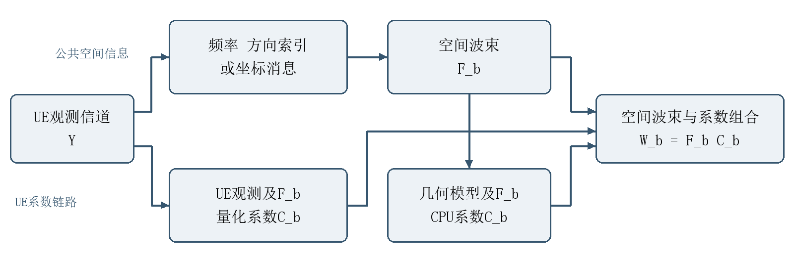

# 单流单极化预编码扩展为双流双极化的最小验证报告

全方法扩展说明与最小可行性验证  2026年10月22日

[下载可转发的Word报告](双流双极化全方法最小验证与扩展说明.docx)

本报告说明如何把原低反馈预编码仿真中的单流单极化结构，扩展为双流双极化结构，并用原有全部方法完成最小可行性验证。原方法包括SVD、Type-I、Type-II、HAQSE R3/R5、DFT R3/R5和POS R3/R5，另保留注水容量参考。

验证结果支持这些方法在当前受控信道模型下形成两个有效接收模式。32个固定位置、两种阵列和两种信道下，共4096条验证记录均通过数值检查；其中1792条可实施双流记录均保持接收秩2。所有UE链路在本次32个位置上均获得正的双流增量；ULA混合信道的DFT CPU链路存在少数负增量位置。可行性成立不代表每个位置都应固定发送两流。

本次目标是补齐方法并验证实现链路。仅固定B为8、观测SNR为30 dB，不进行SNR、AP数、量化精度或极化失配扫描，也不根据这32个位置给出算法排名。

**表1 本次验证范围**

|项目|设置|
|---|---|
|样本|原冻结400位置库中的前32个位置  所有方法共同使用|
|独立流程预检查|原库第399和400个位置  与32个验证位置不重叠|
|阵列与信道|ULA64及UPA32×32  LOS及六散射体混合信道|
|发送配置|同一双极化硬件分别发送1流和2流|
|功率与带宽|总功率1  可实施方法每AP功率1/8  带宽20 MHz|
|极化条件|标称已知极化方向  无新增姿态或端口相位失配|

需要区分两个概念：单流是发送的数据流数为1，并不表示联合多AP信道只能有一个空间模式；双极化描述每个空间阵元的两个极化端口，也不等同于自动获得两个无干扰数据流。

## 一 从向量预编码扩展为矩阵预编码

原模型中，每个AP有N个单极化空间阵元，UE有4个接收空间位置，单AP信道为4×N，预编码为N×1向量。原方案利用一个空间波束和一个AP间复系数承载单流。

$$
\mathbf w_b=\mathbf f_b c_b
$$

扩展时保留原空间坐标、阵元间距和AP朝向。每个空间阵元改为两个±45°极化端口，UE为4个空间位置乘2个极化端口，共8个接收端口。单AP信道变为8×2N，双流预编码变为2N×2矩阵。

**表2 每AP矩阵维度变化**

|场景|原信道|扩展信道|双流预编码|
|---|---|---|---|
|ULA64|4×64|8×128|128×2|
|UPA32×32|4×1024|8×2048|2048×2|

$$
\mathbf W_b=(\mathbf I_2\otimes\mathbf f_b)\mathbf C_b=\mathbf F_b\mathbf C_b
$$

F_b为2N×2，给两个极化端口配置相同的公共空间波束；C_b为2×Ns，其中Ns为发送流数。单流时C_b是2×1向量，双流时为2×2矩阵。它决定两个极化端口的配比、跨AP相对相位及各流的线性组合，因此不能直接把旧的一个共相位复制给两个流。

真信道保留逐阵元球面传播距离，LOS使用横向投影Jones矩阵描述极化耦合；六条散射路径分别加入极化耦合矩阵，设置XPR为10 dB，再按原K为10 dB的Rician规则合成。极化按中心射线计算，并归一路径极化矩阵范数。这是受控双极化模型，尚不是完整3GPP或实测信道。

## 二 原有方法分别怎样扩展

本次保留原方法获取空间波束的区别，并把后续的AP单流系数统一扩展为双极化多流矩阵。HAQSE、DFT和POS分别运行CPU与UE两条链路；Type-I和Type-II按原仓库定义继续使用UE观测CSI，作为两类链路共享的基线。

**表3 方法与空间消息**

|方法|UE反馈的空间信息|CPU恢复空间波束|
|---|---|---|
|HAQSE R3/R5|参考AP的量化空间频率 每维14 bit|由频率定位 参考AP保留直接频率波束 其余AP由位置推断|
|DFT R3/R5|参考AP的DFT波束索引|由索引定位 参考AP保留直接索引波束 其余AP由位置推断|
|POS R3/R5|连续HAQSE方向在UE定位后的量化坐标|全部AP波束由解码坐标生成 包括参考AP|
|Type-I|每AP一个DFT空间波束索引|直接恢复每AP空间波束 两极化共用|
|Type-II|每AP两个空间索引及复合波束的幅相索引|恢复每AP双波束复合结果 两极化共用|
|SVD等功率参考|真实完整信道 不设有限反馈预算|前Ns个真实右奇异向量 每流功率1/Ns|
|注水容量参考|真实完整信道 不设有限反馈预算|最多Ns流注水容量 放松每AP功率约束|

双极化参考AP的观测可整理成16个空间快拍。HAQSE按观测能量选4个快拍后调用原估计器。DFT参考方向则由本地观测前两个模式在两种发射极化上的空间能量评分选取；Type-I和Type-II对联合观测前两个模式作相同形式的空间评分。两个发送流数共用所选波束，以便检查在同一子空间内从一流增加到两流的效果。

Type-II保留原仓库的双波束复合形式。先在原正交DFT分组内选两个能量较强的波束，再由它们的2×2投影协方差主特征向量获得相对幅相。相对幅度量化为3 bit，相对相位量化为2 bit，复合为空间波束后，再乘2×Ns的C_b。此处没有扩大为每极化两个独立波束再接4×Ns系数的更一般结构。

为检查扩展是否保留原定义，构造单模式且只有一个发射极化有效的退化信道。新Type-I和Type-II解码得到的空间波束、方向bit和内部组合bit均与原实现一致，最大波束差为0。本报告中的Type-I和Type-II指仓库的简化结构扩展，不声称完整标准码本符合性。

## 三 有效信道 系数编码和功率控制

把各AP的H_b F_b按列拼接，得到8×2B的有效信道E。UE链路使用带噪观测得到的有效信道，CPU链路用解码位置、公开AP几何和已知标称极化方向重构局部平面LOS有效信道。CPU没有读取真实信道或UE观测CSI。

$$
\mathbf E=[\mathbf H_1\mathbf F_1,\ldots,\mathbf H_B\mathbf F_B]
$$

以前Ns个右奇异向量初始化C，将每个AP的2×Ns系数块归一到Frobenius范数1/√B。由于F_b的两列正交且单位范数，这保证每AP总功率为1/B，并保证所有AP与所有流合计总功率为1。该逐AP归一是启发式设计，不保证原SVD正交性或每AP功率约束下的全局最优。

$$
\|\mathbf C_b\|_F^2=1/B,\quad\sum_b\|\mathbf W_b\|_F^2=1
$$

UE系数逐复数采用幅度3 bit和相位4 bit，并为每流固定一个不影响速率的全局相位锚。CPU只接收整数索引，解码后再次逐AP归一。原来的跨AP共相位已经包含在系数相位中，不再重复计费。CPU链路直接在CPU计算系数，不发送UE系数消息。

$$
L_C=2BN_s(q_A+q_P)-N_sq_P
$$

B为8时，单流系数为108 bit，双流为216 bit。POS坐标统一沿用相位敏感度分配：ULA为24 bit，x/y各12 bit；UPA为36 bit，x/y/z分别13/14/9 bit。R3与R5坐标预算相同。Type-II另外计每AP的两个方向索引和5 bit内部复合系数。

**表4 B为8时的双流有效载荷 bit**

|方法|CPU ULA|CPU UPA|UE ULA|UE UPA|
|---|---|---|---|---|
|HAQSE R3|42|84|258|300|
|HAQSE R5|70|140|286|356|
|DFT R3|27|42|243|258|
|DFT R5|45|70|261|286|
|POS R3|24|36|240|252|
|POS R5|24|36|240|252|
|TypeI|UE基线|UE基线|288|328|
|TypeII|UE基线|UE基线|400|480|

流数、码本配置和参考AP集合预先约定。本次不含自适应RI、消息头和导频开销；也不将反馈占用从吞吐量中扣除。旧单极化单流的52/64 bit属于另一种消息格式，不能用来描述本轮双极化UE链路。

## 四 最小验证怎样运行与判定

先在第399和400个位置进行独立流程预检查，再用预先固定的前32个位置确认。选择位置时没有依据本轮结果筛选；同一阵列与信道下，所有方法和流数共享真实信道、标准噪声及观测SNR。新端口噪声沿用既有双极化模块的固定种子规则，按当前协作信道平均元素功率缩放。

**表5 验证规模和判据**

|项目|执行内容|
|---|---|
|方法覆盖|原九方法配置 加注水容量参考|
|每个位置的设计数|6个几何方法乘CPU/UE 加Type-I/II 加SVD/容量 共16种|
|正式记录数|2阵列×2信道×32位置×2流数×16设计 共4096条|
|流程预检查|2个不重叠位置 共256条记录|
|接收双流判据|有效接收矩阵H W的两个奇异值均非零|
|数值检查|整数消息 解码功率 CPU/UE空间消息一致性 速率与容量关系|
|回归检查|32位置全部POS结果与先前400位置存档一致 Type-I波束与既有全方向模块一致|

主速率使用线性MMSE接收器逐流SINR计算，吞吐量等于20乘以频谱效率，单位Mbps。同时记录联合解码速率和真实信道注水容量，核查MMSE不超过联合解码速率，联合解码速率不超过对应秩的容量参考。单流时MMSE与联合解码结果一致。

$$
R=20\sum_{s=1}^{N_s}\log_2(1+\mathrm{SINR}_s)
$$

4096条记录通过核查；1792条可实施双流记录全部保持接收秩2，最弱的第二/第一接收模式功率比为0.02731。独立程序重新解码2048条UE系数消息和1024条坐标消息，功率误差低于10⁻¹⁴，无坐标溢出。新增Type-I/II退化回归8项检查通过，预检查中的POS重算差约5.12×10⁻¹³ Mbps，32位置POS与已发布结果差为0。

接收端评估使用真实有效信道计算MMSE SINR，未另加接收信道估计误差。SVD等功率参考与注水容量参考都使用真实完整信道，并放松每AP功率约束；前者不是一般容量上界。两个参考不属于有限反馈可实施方案。

## 五 ULA最小验证结果

表中为32个位置的平均MMSE吞吐量，单位Mbps。全部使用B为8、观测SNR为30 dB和同一双极化硬件。CPU与UE行分别为六个几何方法的两条链路；Type-I/II为共享UE基线。这里只检查同一方法从一流扩展到两流的行为，不作跨方法排名。

**表6 ULA单流与双流结果**

|方法与链路|LOS一流|LOS两流|混合一流|混合两流|
|---|---|---|---|---|
|HAQSE R3 CPU|103.68|169.11|101.38|163.57|
|HAQSE R5 CPU|103.64|168.75|101.23|162.28|
|DFT R3 CPU|93.88|147.21|84.59|128.43|
|DFT R5 CPU|97.90|154.38|88.74|134.20|
|POS R3 CPU|103.59|168.93|101.55|163.77|
|POS R5 CPU|103.71|168.74|101.29|162.09|
|HAQSE R3 UE|108.85|178.46|106.38|173.26|
|HAQSE R5 UE|108.85|178.46|106.40|173.27|
|DFT R3 UE|108.76|178.17|98.09|155.71|
|DFT R5 UE|108.79|178.23|102.56|165.20|
|POS R3 UE|108.85|178.46|106.38|173.24|
|POS R5 UE|108.85|178.46|106.39|173.26|
|TypeI|108.85|178.46|106.36|173.01|
|TypeII|109.84|180.63|107.28|175.33|
|SVD等功率参考|116.45|186.01|116.19|186.18|
|注水容量参考|116.45|186.02|116.19|186.18|

本阵列所有方法在两种信道下的平均双流增量均为正，范围为43.84至70.79 Mbps。实际链路均保持两个非零接收模式，因此HAQSE、DFT、Type-I和Type-II也具备本次模型下的双极化双流可行性。

需要保留的失败样本信息是：混合信道中，DFT R3 CPU有28/32个位置获得双流正增量，4个位置降低，最差降低4.98 Mbps；DFT R5 CPU为31/32个位置正增量，1个位置降低，最差降低17.95 Mbps。其余可实施配置本次均为32/32正增量。形成两个非零模式与固定发两流总能提速是不同判据，后续若研究自适应流数，应额外设计RI决策并计入其开销。

## 六 UPA最小验证结果

表中为32个位置的平均MMSE吞吐量，单位Mbps。全部使用B为8、观测SNR为30 dB和同一双极化硬件。CPU与UE行分别为六个几何方法的两条链路；Type-I/II为共享UE基线。这里只检查同一方法从一流扩展到两流的行为，不作跨方法排名。

**表7 UPA单流与双流结果**

|方法与链路|LOS一流|LOS两流|混合一流|混合两流|
|---|---|---|---|---|
|HAQSE R3 CPU|177.53|321.11|172.91|309.44|
|HAQSE R5 CPU|177.74|321.91|173.88|311.64|
|DFT R3 CPU|161.03|268.83|157.72|259.91|
|DFT R5 CPU|163.61|275.75|160.86|272.17|
|POS R3 CPU|177.77|322.04|172.65|308.19|
|POS R5 CPU|177.86|322.23|173.73|311.33|
|HAQSE R3 UE|177.93|321.77|176.88|316.98|
|HAQSE R5 UE|177.93|321.77|176.90|317.01|
|DFT R3 UE|177.63|320.71|176.51|316.48|
|DFT R5 UE|177.56|320.64|176.53|316.68|
|POS R3 UE|177.97|321.83|176.94|317.06|
|POS R5 UE|177.97|321.83|176.98|317.06|
|TypeI|177.93|321.77|176.71|316.01|
|TypeII|177.96|321.99|177.89|316.98|
|SVD等功率参考|191.75|341.15|192.43|340.94|
|注水容量参考|191.75|341.15|192.43|340.94|

本阵列所有方法在两种信道下的平均双流增量均为正，范围为102.19至144.37 Mbps。实际链路均保持两个非零接收模式，因此HAQSE、DFT、Type-I和Type-II也具备本次模型下的双极化双流可行性。

UPA的所有可实施方法在LOS和混合信道下均为32/32个位置获得正的双流增量。CPU的DFT链路仍比其UE链路存在较大平均差距，与粗方向经定位后参与相干系数设计的敏感性一致；该观察不能替代对定位、极化和多径误差的独立因果分解。

## 七 当前结论与复现入口

本轮完成了全部原方法的最小补齐。共同可扩展部分是把AP的单流复系数改为2×Ns矩阵，使极化配比、跨AP相位和流间线性组合在同一低维有效信道上设计；各方法原有的频率、方向、位置或双波束消息仍各自保留。

当前证据支持实现层面的双流双极化可行性：所有可实施配置满足同总功率和每AP功率约束，全部双流样本保持接收秩2，各方法平均速率相对单流均有增加。DFT CPU的少数负增量位置说明，实际是否发送两流仍与工作点及信道估计质量有关。UE系数来自观测有效信道，CPU系数依赖位置和标称极化模型，两者信息条件不同，应分别解读。

验证仅限固定部署、32个位置、标称极化、窄带单用户和B为8的一个观测工作点。Type-II采用原复合双波束结构的最小扩展，Type-I/II未做完整标准符合性验证。未覆盖独立部署重复、宽带频率选择性、多用户干扰、移动跟踪或接收端信道估计误差。本报告不据此宣称任何方法最优；是否扩大性能对比范围，由后续研究目标决定。

**表8 复现文件**

|文件|用途|
|---|---|
|verify_minimal_all_methods.m|检查Type-I/II单模式单极化退化一致性|
|run_minimal_all_methods.m|执行smoke和confirm 固定全部方法与样本|
|+min9/|参考方向消息 基线消息与整数解码|
|analyze_minimal_all_methods.py|独立解码审计 单双流逐样本配对|
|build_minimal_reports.py|由同一数据内容生成Markdown和Word|
|confirm/trials.csv与paired_summary.csv|逐样本结果及同方法单双流均值|
|complete_audit.json与source_and_input_SHA256.json|验证范围 数值检查及源码输入校验|

MATLAB R2024a进入第7目录，依次运行verify_minimal_all_methods、run_minimal_all_methods("smoke")和run_minimal_all_methods("confirm")；随后用含numpy、pandas、python-docx和Pillow的Python环境运行分析脚本，再运行报告构建脚本。沿用第6目录的冻结输入及算法依赖，既有+dmimo模块不作修改。

Markdown与Word采用同一组说明、公式和数据表生成。Markdown中的表格可直接检索；Word中的数据表与核心公式可编辑，转发时无需依赖本地源文件。

仓库入口 https://github.com/ttal6688/ZTE_codebokk
